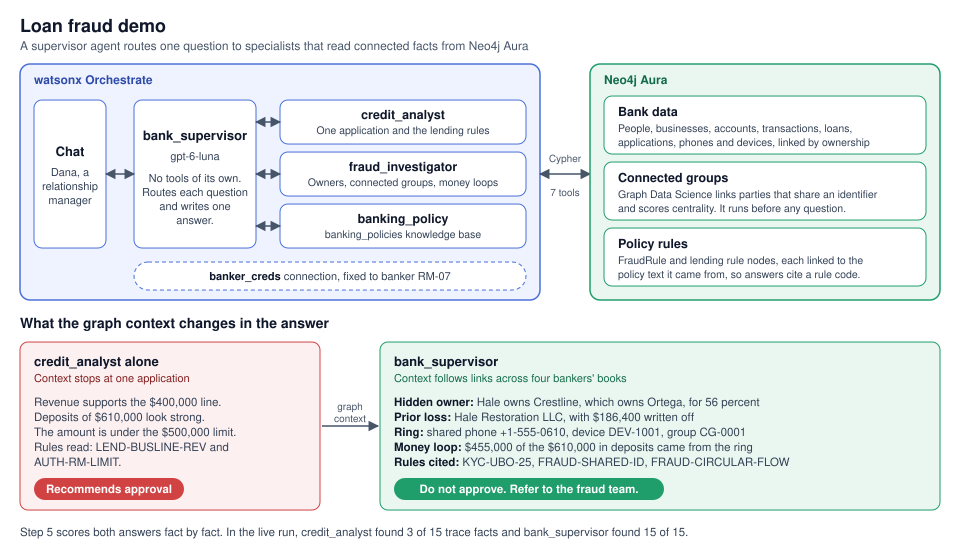
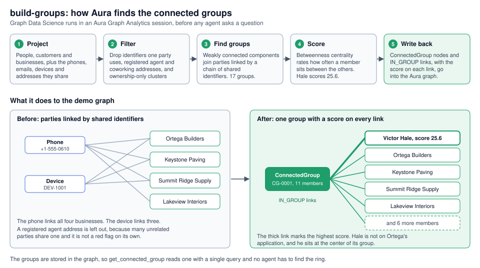
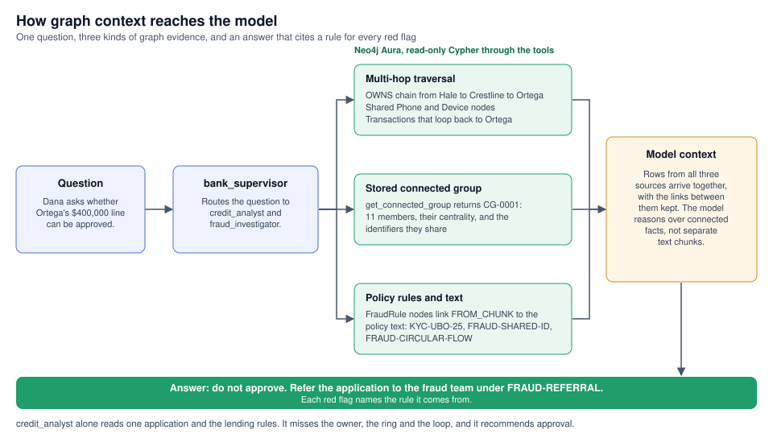

# Loan Fraud Demo Walkthrough



The top half shows who does the work. `bank_supervisor` routes Dana's question to three specialists in watsonx Orchestrate. Their tools run Cypher against Neo4j Aura, which holds the bank data, the connected groups that Graph Data Science found, and the policy rules. The bottom half shows the result. `credit_analyst` alone sees one application and recommends approval. With graph context, the supervisor finds the hidden owner, the ring, and the money loop.

This walkthrough runs the staff demo from start to finish. A relationship manager asks whether a loan can be approved. The application looks clean. The graph shows that it is part of a fraud ring.

After you set the scene, the demo has five steps: the failure, the fix, the follow-up, how GraphRAG changed the answer, and the proof. The runner takes about 3 minutes. With the talking points, allow about 10 minutes.

You can present it two ways. Run it from a terminal, as the next section shows, or follow the steps below in the Orchestrate chat and the Aura Query tool. Both ask the same questions and give the same answers.

---

## Run it from a terminal

One command runs the whole demo:

```bash
uv run fraud-demo-walkthrough
```

The runner calls watsonx Orchestrate itself, so the audience sees Neo4j and Orchestrate working together. It does no setup. It inspects what the setup loaded, then asks the agents the demo's questions. It has eleven steps, and each step also runs on its own:

| Runner step | What it shows | Walkthrough section |
|---|---|---|
| 1 | The tenant: the active environment and the models | [What Orchestrate holds for this demo](#what-orchestrate-holds-for-this-demo) |
| 2 | The `banker_creds` connection is loaded | [What Orchestrate holds for this demo](#what-orchestrate-holds-for-this-demo) |
| 3 | The seven staff tools are loaded | [What Orchestrate holds for this demo](#what-orchestrate-holds-for-this-demo) |
| 4 | The four staff agents and the `banking_policies` knowledge base are loaded | [What Orchestrate holds for this demo](#what-orchestrate-holds-for-this-demo) |
| 5 | What Aura holds: the connected groups Graph Data Science found, queried from Aura | [What Aura holds for this demo](#what-aura-holds-for-this-demo) |
| 6 | Set the scene: the application facts, queried from Aura for `APP-1001` | [Step 1](#step-1-set-the-scene) |
| 7 | The failure: `credit_analyst` recommends approval | [Step 2](#step-2-the-failure) |
| 8 | The fix: `bank_supervisor` in a new chat, then the connected group the fraud tools read | [Step 3](#step-3-the-fix) |
| 9 | The follow-up: the same chat as step 8 | [Step 4](#step-4-the-follow-up) |
| 10 | How GraphRAG changed the answer: scores `credit_analyst` against `bank_supervisor` fact by fact | [Step 5](#step-5-how-graphrag-changed-the-answer) |
| 11 | The proof: runs `orchestrate/fraud_proof_query.cypher` against Aura | [Step 6](#step-6-the-proof-in-neo4j-aura) |

| Option | Effect |
|---|---|
| `--steps` | Runs only some steps, for example `--steps 3`, `--steps 7-9`, or `--steps 1,4` |
| `--thread-id` | Gives step 9 the chat thread from step 8 when you run it alone |
| `--skip-scoring` | Skips the fact-by-fact scoring in step 10 |
| `--out-dir` | Sets where the runner writes the files it saves |

Each step prints the same parts in the same order:

- **Header:** The step number and title.
- **Where line:** Where the step runs, either locally against Aura or in the Orchestrate cloud.
- **What:** The Neo4j and watsonx story behind the step. It says what context the graph gives the agent and how that changes the answer.
- **How:** The mechanics of the step. It says what runs where, and whether Orchestrate or Aura does the work.
- **Command:** The exact `orchestrate` command or Cypher the step runs, so the audience can see that nothing is hidden.
- **Output:** What the command returned.
- **Captured values:** The values a later step uses, such as the thread ID that step 9 continues.

---

## The story

Dana Whitfield is a relationship manager at the bank. Ortega Builders, one of Dana's clients, has applied for a $400,000 line of credit. The deposits look strong, and the amount is under Dana's approval limit. On paper, Dana can approve it without anyone else.

Three facts sit outside the application, spread across other bankers' books:

- **Hidden owner:** Victor Hale controls Ortega Builders through a holding company. Hale ran a business that left the bank with a written-off loan.
- **Hidden ring:** Ortega and three other businesses applied for credit in the same few weeks. All four list Hale's phone number, and three applied from the same device.
- **Money loop:** Most of Ortega's strong deposits came from the other three businesses, a few days after Ortega sent them money.

A credit specialist working alone says yes. A supervisor that asks a credit specialist and a fraud specialist recommends a referral to the fraud team.

---

## Cast

| Name | ID | Role in the demo |
|---|---|---|
| Dana Whitfield | `RM-07` | The relationship manager who asks every question |
| Victor Hale | `P-1001` | The hidden owner at the center of the ring |
| Luis Ortega | `P-1002` | Ortega Builders' director, who owns 30 percent of it |
| Crestline Holdings | `B-1001` | Hale's holding company. Its only address is a registered agent service in Dover. |
| Ortega Builders | `B-1002` | Dana's client and the applicant |
| Hale Restoration LLC | `B-1003` | Hale's old business, whose loan was written off |
| Keystone Paving | `B-1004` | Ring member, managed by Tom Becker, `RM-03` |
| Summit Ridge Supply | `B-1005` | Ring member, managed by Alicia Romero, `RM-05` |
| Lakeview Interiors | `B-1006` | Ring member, managed by Grant Holloway, `RM-09` |

All scenarios use the demo date of October 8, 2026.

---

## Agents

| Agent | Model | What it does in the demo |
|---|---|---|
| `credit_analyst` | gpt-oss-120b | It checks the application against the lending and approval rules. It is the failure step when asked alone. |
| `fraud_investigator` | gpt-oss-120b | It finds the real owners, the connected group, and any money loops. |
| `banking_policy` | gpt-oss-120b | It answers general policy questions from the knowledge base. |
| `bank_supervisor` | gpt-6-luna | It sends each question to the right specialists and writes the final answer. It has no tools of its own. |

Every staff tool reads the `banker_creds` connection. The connection is fixed to Dana's banker ID, `RM-07`, so every chat runs as Dana.

---

## Before you start

Check each item before the audience arrives.

- **Graph:** The demo's Aura instance holds the rebuilt graph. The rebuild loads the fraud data and runs the connected group step. The connected group step creates an Aura Graph Analytics session, which is billed while it runs.
- **Checks:** The data validation and the test suite both pass.
- **Orchestrate:** The tenant token is fresh and the staff demo is built. The pre-flight check confirms the connection, the seven tools, the four staff agents with their collaborators, and the knowledge base.
- **Aura console:** The proof query from [Step 6](#step-6-the-proof-in-neo4j-aura) is saved in your own Aura console. Aura saved queries belong to the user who saves them.
- **Browser tabs:** Open one tab with the Orchestrate chat and one with the Aura Query tool.

Rebuild the graph:

```bash
make rebuild
```

Validate the data:

```bash
uv run validate-data
```

Run the tests:

```bash
make test
```

Refresh the tenant token:

```bash
make wxo-env
```

If the staff demo is not built yet, build it:

```bash
make wxo-staff-setup
```

Run the pre-flight check:

```bash
uv run fraud-demo-walkthrough --steps 1-4
```

By hand, this command shows the four staff agents. `bank_supervisor` lists `credit_analyst`, `fraud_investigator`, and `banking_policy` as collaborators.

```bash
orchestrate agents list
```

---

## What Aura holds for this demo

Neo4j Aura holds the bank as one graph. Customers, people, businesses, accounts, transactions, loans, and applications are nodes. Ownership, shared phones and devices, and money transfers are links between them. The policies are in the graph too, and each rule links to the policy text it comes from.

### Connected groups

The key step in the rebuild is `build-groups`. It runs Neo4j Graph Data Science in an Aura Graph Analytics session, before any agent asks a question.



The diagram shows the five stages of `build-groups` and what they do to the demo graph. Four businesses start out linked by a shared phone, and three of them by a shared device. The step ends with one `ConnectedGroup` node that holds the members, with a centrality score on each `IN_GROUP` link.

- **Shared links:** The step projects people, customers, and businesses with the phones, emails, devices, and addresses they share. It adds ownership and director links. An identifier that only one party uses links nothing, so it is left out.
- **Normal links:** Registered agent and coworking addresses are left out, because `FRAUD-REG-AGENT` says they are not red flags on their own. A cluster held together only by ownership is dropped, because an owner with several businesses is normal.
- **Groups:** Weakly connected components join every party linked by a chain of shared identifiers. Each cluster becomes a `ConnectedGroup` node. The demo graph holds 17 groups.
- **Centrality:** Betweenness centrality scores how often each member sits on the paths between the others. The score is stored on the member's `IN_GROUP` link.
- **Ortega's group:** Ortega Builders is in `CG-0001`, the largest group, with 11 members. Victor Hale has the highest score in it, 25.6, and he is not on Ortega's application.

The groups are written into the graph, so a tool reads them with one query. `get_connected_group` returns a business's group, its members with their centrality, and the identifiers they share. `screen_business` and `find_circular_flows` also check whether two parties are in the same group. The ring spans four bankers' books, so no single banker can see it. The graph sees across all of them.

**Run it:**

```bash
uv run fraud-demo-walkthrough --steps 5
```

The terminal runs a read-only Cypher query against Aura. It does not run `build-groups`, so it starts no billed session.

**What the audience sees:** A table of the 17 groups, with each group's size and its most central member. `CG-0001` is the only group that holds Ortega Builders. It has 11 members, and Victor Hale is at its center with a score of 25.60.

**Say:** "Before anyone asks a question, Graph Data Science scans the whole bank for parties that share a phone, a device, or an address. It writes each cluster back to the graph as a group and scores who sits at the center. The agent does not have to find the ring. It reads it from the graph."

---

## What Orchestrate holds for this demo

Before the first question, show what Orchestrate holds. Each item is a feature of the platform. Runner step 1 shows the active environment and the models first. Runner steps 2 to 4 show each item below.

### The connection

**What:** Orchestrate keeps the Neo4j Aura credentials in a managed connection, `banker_creds`. Every staff tool reads it, so no password sits in a prompt or a file. The connection also fixes the banker to Dana, so every chat runs as Dana.

**Run it:**

```bash
uv run fraud-demo-walkthrough --steps 2
```

**Command:** `orchestrate connections list --verbose`, filtered to `banker_creds`

**What the audience sees:** The `banker_creds` connection exists for draft and live, and its credentials are entered. The values are never shown.

**Say:** "Orchestrate holds the Aura credentials in a managed connection. They are not in the code or in the agent's instructions. The connection also fixes the signed-in banker to Dana, so no prompt can change whose book the tools read."

### The tools

**What:** These seven Python tools are how the agents reach the graph. Each one runs a Cypher query in Neo4j Aura from inside Orchestrate. Three answer credit questions about one application. Four follow links across the graph: owners behind owners, shared phones and devices, and money that moves in a loop.

**Run it:**

```bash
uv run fraud-demo-walkthrough --steps 3
```

**Command:** `orchestrate tools list --verbose`

**What the audience sees:** Seven staff tools: `find_my_client`, `get_application`, `check_lending_rules`, `get_beneficial_owners`, `get_connected_group`, `find_circular_flows`, and `screen_business`. Each one is bound to `banker_creds`.

**Say:** "These are Python tools that run in Orchestrate's hosted runtime. Each one opens a connection to Neo4j Aura with the managed credentials and runs a query. Nothing runs on this laptop."

### The agents

**What:** Orchestrate routes the work between specialists. `credit_analyst` sees one application. `fraud_investigator` sees the network around it. `bank_supervisor` has no tools. It asks both and writes one answer.

**Run it:**

```bash
uv run fraud-demo-walkthrough --steps 4
```

Step 4 shows the agents first, then the knowledge base.

**Command:** `orchestrate agents list --kind native --verbose`

**What the audience sees:** The four staff agents with their model, tools, and collaborators.

- `credit_analyst` uses `find_my_client`, `get_application`, and `check_lending_rules`.
- `fraud_investigator` uses `find_my_client` and `screen_business`.
- `banking_policy` uses the `banking_policies` knowledge base and no tools.
- `bank_supervisor` has no tools. Its collaborators are `credit_analyst`, `fraud_investigator`, and `banking_policy`.

**Say:** "Each specialist has a narrow job. The supervisor has no tools of its own. It routes each question to the right collaborators and writes one answer. That is Orchestrate's multi-agent routing."

### The knowledge base

**What:** The `banking_policies` knowledge base holds the policy documents for plain vector search. The graph holds the same policies as rules. Each rule links to its policy text and to the facts it applies to, which is what lets an answer cite a rule code.

**Run it:**

```bash
uv run fraud-demo-walkthrough --steps 4
```

This is the same step as the agents.

**Command:** `orchestrate knowledge-bases status -n banking_policies --verbose`

**What the audience sees:** The `banking_policies` knowledge base is ready, with its policy documents listed.

**Say:** "Orchestrate chunks, embeds, and indexes the policy documents itself. The `banking_policy` agent answers from it. The graph holds the same policies as rules, so the other agents can link a rule to the facts it applies to."

---

## Step 1: Set the scene

**What:** This is one loan application, as Neo4j Aura stores it. Ortega Builders asks for $400,000, revenue supports it, and it is under Dana's limit. Every fact here is true, and none of them looks suspicious. The risk is in the links around this application.

**Run it:**

```bash
uv run fraud-demo-walkthrough --steps 6
```

The terminal runs a Cypher query against Aura and prints the application facts below.

**Say:** "Dana is a relationship manager. Dana's client, Ortega Builders, wants a $400,000 line of credit. Let's see what an AI assistant says."

Show the application facts:

| Fact | Value |
|---|---|
| Application | `APP-1001`, a business line of credit |
| Amount | $400,000 |
| Stated annual revenue | $2,440,000 |
| Deposits in the last 90 days | $610,000 |
| Dana's approval limit | $500,000 |

The lending rule `LEND-BUSLINE-REV` allows a line of up to 25 percent of verified annual revenue. The credit check takes revenue from the last 90 days of deposits: $610,000 times four, which is $2,440,000. So the largest line is $610,000, and the request fits. It is also under Dana's limit under `AUTH-RM-LIMIT`.

---

## Step 2: The failure

**What:** `credit_analyst` reads the graph, but only the application and the lending rules. Its context stops at one node, so it sees strong deposits and a request under the limit. Watch it recommend approval.

**Run it:**

```bash
uv run fraud-demo-walkthrough --steps 7
```

The terminal runs `orchestrate chat ask -n credit_analyst`, then prints the tool calls and the answer.

**Agent:** `credit_analyst`

**Prompt:** "Ortega Builders applied for a $400,000 line of credit. Their deposits look strong. Can I approve it?"

**What happens:** The agent looks up the application in the graph. Revenue supports the request, and the amount is under Dana's limit. It recommends approval.

**Say:** "This agent has the bank's data, and it still says yes. A credit check looks at one application. It cannot see who owns the business, who else applied, or where the deposits came from. Those facts live in other bankers' books."

---

## Step 3: The fix

**What:** `bank_supervisor` sends the same question to `credit_analyst` and `fraud_investigator`. The fraud tools follow multi-hop paths in the graph: an owner hidden behind a holding company, a shared phone and device, and money that loops back. The model now reasons over connected facts, and each red flag names the rule it comes from.

Start a new chat for this step. Step 4 runs in the same chat.

**Run it:**

```bash
uv run fraud-demo-walkthrough --steps 8
```

The terminal runs `orchestrate chat ask -n bank_supervisor` in a new chat, prints the calls to the two specialists, and prints the answer. It captures the thread ID for Step 4.

Then, in part 8.1, the terminal prints the connected group the fraud tools read. It calls `get_connected_group` for Ortega Builders locally, the same function the Orchestrate tool runs. It prints the 11 members of `CG-0001` with their centrality and banker, and the identifiers they share: the phone, an email, the device, and a home address. The last line names the tool that read the group in this chat, usually `screen_business`.

**Say at 8.1:** "Graph Data Science found this group before the chat began. The fraud specialist read it in one call. Hale is at the center, and he is not on Ortega's application. The group reaches into three other bankers' books, so Dana could never see it alone."

**Agent:** `bank_supervisor`

**Prompt:** Use the same prompt as Step 2.

**What happens:** The supervisor sends the question to `credit_analyst` and `fraud_investigator`. The credit check passes. The fraud check finds the red flags. The supervisor opens with one recommendation, then writes a "Credit check" section and a "Fraud check" section.

**What the answer contains:**

- **Recommendation:** Do not approve. Refer the application to the fraud team under `FRAUD-REFERRAL`, because it matches two or more red flags.
- **Hidden owner:** Crestline Holdings owns 70 percent of Ortega Builders. Victor Hale owns 80 percent of Crestline. Hale's effective share of Ortega is 56 percent, so Hale is a beneficial owner under `KYC-UBO-25`. Neither Hale nor Crestline appears on the application.
- **Prior loss:** Hale Restoration LLC, which Hale owns, had a $250,000 term loan. The bank wrote off $186,400 of it on February 28, 2025. That matches `FRAUD-PRIOR-LOSS`.
- **Hidden ring:** Ortega, Keystone Paving, Summit Ridge Supply, and Lakeview Interiors all applied in the last three weeks. All four list the phone number `+1-555-0610`, which is Hale's. Ortega, Keystone, and Summit applied from the same device. The four businesses sit in one connected group, and Hale is its most central member. That matches `FRAUD-SHARED-ID`.
- **Money loop:** Ortega received $610,000 in the last 90 days. Ortega sent $370,000 to Keystone, Summit, and Lakeview, and $455,000 came back from them. That matches `FRAUD-CIRCULAR-FLOW`.
- **Revenue:** The loop money does not count as revenue. Only $155,000 came from outside clients.
- **Warning:** Do not tell Ortega Builders about the referral, under `AML-NO-TIPOFF`.

Luis Ortega may appear as a 30 percent beneficial owner and Ortega's director. That is correct, and it is not a red flag.

**What to point out in Orchestrate:** Open the step history. It shows one call to `credit_analyst` and one call to `fraud_investigator`, and no call to `banking_policy`.

**Say:** "The answer says the application matches these red flags. It does not say anyone committed fraud. Dana decides. Each red flag names the policy rule it comes from."

---

## Step 4: The follow-up

**What:** The same chat continues. The supervisor remembers the fraud referral from Step 3, so it sends this question to `banking_policy` alone. The graph findings shape the next answer, and Dana gets words that do not tip off the client.

Run this step in the same chat as Step 3.

**Run it:**

```bash
uv run fraud-demo-walkthrough --steps 9
```

The terminal runs `orchestrate chat ask -n bank_supervisor --thread-id <thread ID> -r "<prompt>"` with the thread that step 8 captured. The terminal prints the call to `banking_policy` and the answer.

To run it alone, pass the thread ID from step 8:

```bash
uv run fraud-demo-walkthrough --steps 9 --thread-id <thread ID>
```

**Agent:** `bank_supervisor`

**Prompt:** "Ortega's owner called asking why the line is delayed. What can I tell him?"

**What happens:** This is a policy question, so the supervisor sends it to `banking_policy` alone. It adds one sentence of context from the chat: the line is Ortega Builders' application, and the supervisor recommended a fraud referral.

**What the answer contains:**

- **Rule:** Dana must not mention the referral or the fraud review, under `AML-NO-TIPOFF`.
- **Wording:** The answer gives the suspicious activity policy's script: "Your application is still in review. Reviews can take longer when we need to verify more information. We will contact you when the review is complete."

The answer does not name Victor Hale or Crestline, and gives no phone, device, or amount from Step 3.

**What to point out in Orchestrate:** The step history shows one call to `banking_policy` and no call to the other specialists.

**Say:** "Staff can break bank policy by saying too much. The supervisor knew from the chat that a referral was recommended, so it asked the policy specialist the right question. Dana gets words that are safe to use."

---

## Step 5: How GraphRAG changed the answer



The diagram follows one question. `bank_supervisor` routes it, and the tools read three kinds of evidence from Aura: a multi-hop traversal, the stored connected group, and the policy rules with their text. The rows arrive in the model's context together, so the answer can cite a rule for every red flag.

**What:** Now the difference gets measured. The same Scenario E prompt goes to `credit_analyst` and to `bank_supervisor`, and each answer is scored fact by fact. Only the agent with multi-hop graph context finds the hidden owner, the ring and the money loop.

**Run it:**

```bash
uv run fraud-demo-walkthrough --steps 10
```

The terminal sends Scenario E to `credit_analyst` and `bank_supervisor` again, then scores each answer fact by fact. Add `--skip-scoring` to leave this step out.

In Step 2 the credit specialist ran alone. In Step 3 the supervisor also routed to `fraud_investigator`, whose graph tools found every fact below. Each row is one answer fact of Scenario E.

| Fact | `credit_analyst` alone | `bank_supervisor` | Graph pattern that found it |
|---|---|---|---|
| Victor Hale | Missed | Found | Multi-hop `OWNS` links, from Hale through Crestline to Ortega |
| Hale's effective share is 56 percent | Missed | Found | Multi-hop `OWNS` links through Crestline |
| The loan was written off | Missed | Found | `OWNS` to Hale Restoration, then `BORROWER_ON` to the loan |
| A shared phone or device | Missed | Found | Shared `Phone` and `Device` nodes |
| $455,000 came from the ring | Missed | Found | A circular flow over `Transaction` links between the ring's accounts |
| Do not approve | Missed | Found | A `FraudRule` linked to its policy `Chunk`, `FRAUD-REFERRAL` |
| Refer to the fraud team | Missed | Found | The same `FraudRule` and `Chunk` |
| Do not tell the client | Missed | Found | The `AML-NO-TIPOFF` rule and its `Chunk` |

The step scores the eight answer facts of Scenario E. In the live run on October 21, 2026, `credit_analyst` passed 39 of 61 checks. Only 3 of 15 trace facts were in its tool results, and the only rule codes were `AUTH-RM-LIMIT` and `LEND-BUSLINE-REV`. `bank_supervisor` passed 61 of 61 checks and found 15 of 15 trace facts. It also returned `KYC-UBO-25`, `FRAUD-PRIOR-LOSS`, `FRAUD-SHARED-ID`, `FRAUD-CIRCULAR-FLOW`, and `FRAUD-REG-AGENT`.

**Say:** "The rules live in the policy text. The graph links each rule to its policy chunk and to the facts it applies to."

---

## Step 6: The proof in Neo4j Aura

**What:** Every fact in the supervisor's answer is a node or a link in Neo4j Aura. This query draws them all: Hale's ownership chain, the written-off loan, the shared phone and device, the money loop, and each rule with its policy text. Anyone can check the answer against the graph.

**Run it:**

```bash
uv run fraud-demo-walkthrough --steps 11
```

The terminal runs `orchestrate/fraud_proof_query.cypher` against Aura and prints the number of paths in each result, then each path. To see the graph, paste the query into the Aura Query tool.

Open the Aura Query tool, run the saved query, and switch to the graph view.

**Nodes to look for:**

- **The hidden holding company:** `Crestline Holdings` (`B-1001`) sits between Victor Hale (`P-1001`) and `Ortega Builders` (`B-1002`). Follow `OWNS` from Hale to Crestline, then from Crestline to Ortega. Neither Hale nor Crestline is on the application.
- **The prior loss:** `Hale Restoration LLC` (`B-1003`) is Hale's other business. Its `BORROWER_ON` link leads to a `Loan` with status `WRITTEN_OFF`.
- **The shared phone:** One `Phone` node, `+1-555-0610`, has four `HAS_PHONE` links, from Ortega, Keystone Paving, Summit Ridge Supply and Lakeview Interiors.
- **The shared device:** One `Device` node, `DEV-1001`, has three `SUBMITTED_FROM` links from the ring's loan applications.
- **The money loop:** `Transaction` nodes run from the ring's accounts into Ortega's account, `A-3001`.
- **The ring:** Hale's `IN_GROUP` link goes to the `ConnectedGroup` node. That link carries the highest centrality score in the group.
- **The rules:** Each `FraudRule` node links to the policy `Chunk` it came from through `FROM_CHUNK`.

```cypher
// The graph behind the Scenario E answer.
MATCH (hale:Person {person_id: 'P-1001'})
RETURN
  COLLECT {
    MATCH p = (hale)-[:OWNS*1..2]->(:Business {business_id: 'B-1002'})
    RETURN p
  } AS hidden_owner,
  COLLECT {
    MATCH p = (hale)-[:OWNS]->(:Business)-[:BORROWER_ON]->(:Loan {status: 'WRITTEN_OFF'})
    RETURN p
  } AS prior_loss,
  COLLECT {
    MATCH p = (:Business)-[:HAS_PHONE]->(:Phone {number: '+1-555-0610'})
    RETURN p
  } AS shared_phone,
  COLLECT {
    MATCH p = (:Business)-[:APPLIED_FOR]->(:LoanApplication)
              -[:SUBMITTED_FROM]->(:Device {device_id: 'DEV-1001'})
    RETURN p
  } AS shared_device,
  COLLECT {
    MATCH p = (:Business)-[:HOLDS]->(:Account)-[:HAS_TRANSACTION]->(:Transaction)
              -[:TO_ACCOUNT]->(:Account {account_id: 'A-3001'})
    RETURN p
  } AS loop_in,
  COLLECT {
    MATCH p = (hale)-[:IN_GROUP]->(:ConnectedGroup)
    RETURN p
  } AS connected_group,
  COLLECT {
    MATCH p = (r:FraudRule)-[:FROM_CHUNK]->(:Chunk)
    WHERE r.rule_code IN ['KYC-UBO-25', 'FRAUD-PRIOR-LOSS', 'FRAUD-SHARED-ID',
                          'FRAUD-CIRCULAR-FLOW']
    RETURN p
  } AS policy_text
```

**What the graph shows:**

- Hale owns Crestline, and Crestline owns Ortega.
- Hale also owns Hale Restoration, which links to the written-off loan.
- Ortega, Keystone, Summit, and Lakeview all point to one phone node.
- Three applications point to one device node.
- Eight transfers flow into Ortega's account from the other three ring accounts.
- Hale sits in the connected group. Hale's `IN_GROUP` link carries the highest centrality score.
- Each rule links to the policy chunk it comes from.

**Say:** "Each fact in the answer is a node or a link here. You can check every one of them."

---

## Reset between presentations

Start a new chat in Orchestrate for each presentation. Step 4 depends on Step 3 being in the same chat. The runner starts a new chat for step 8 each time it runs. The demo writes nothing to the graph, so the graph needs no reset.

---

## If something goes wrong

- **`credit_analyst` does not recommend approval in Step 2:** Ask again in a new chat. The agent sometimes says only that Dana may approve, without recommending approval.
- **The supervisor calls only one specialist in Step 3:** Ask again in a new chat. Note it afterwards, because the supervisor should call both specialists every time.
- **The supervisor's answer leaves out a fact:** The supervisor can shorten a specialist's answer and drop details, such as a rule name. Open that specialist's step in the step history to show its full answer.
- **Step 4 asks which line Dana means:** The supervisor did not add the context sentence, or Step 3 ran in a different chat. Run Step 3 and Step 4 again in one new chat.
- **The chat shows a token or connection error:** Refresh the tenant token.

  ```bash
  make wxo-env
  ```

- **The proof query draws no group:** The connected group step did not run. Rebuild the groups without a full reset. The command creates a billed Aura Graph Analytics session while it runs.

  ```bash
  uv run build-groups
  ```


---

## Key numbers

| Fact | Value |
|---|---|
| Hale's effective share of Ortega | 56 percent, which is 80 percent of 70 percent |
| Beneficial owner threshold | 25 percent |
| Hale Restoration loan | $250,000 term loan, with $186,400 written off on February 28, 2025 |
| Ortega's deposits, last 90 days | $610,000 |
| Loop deposits from the ring | $455,000: $180,000 from Keystone, $160,000 from Summit, and $115,000 from Lakeview |
| Ortega's transfers back to the ring | $370,000 |
| Deposits from outside clients | $155,000 |
| Shared phone | `+1-555-0610`, used by all four applicants |
| Shared device | `DEV-1001`, used by Ortega, Keystone, and Summit |
| Connected groups in the graph | 17, written by `build-groups` |
| Ortega's connected group | `CG-0001`, the largest group, with 11 members |
| Hale's centrality in `CG-0001` | 25.6, the highest in the group |
| Relationship manager approval limit | $500,000 |
