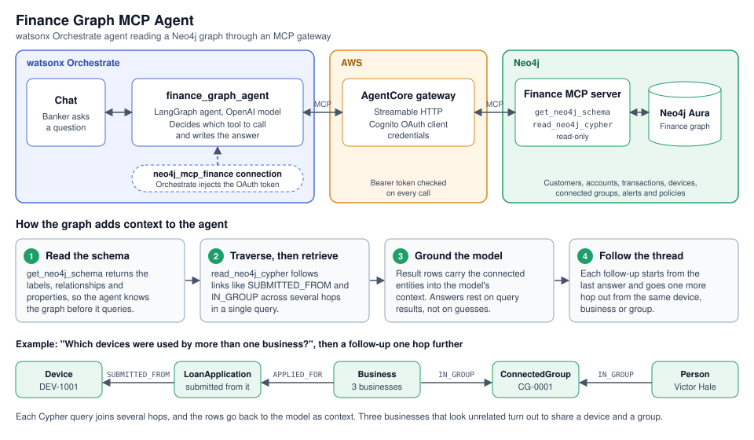
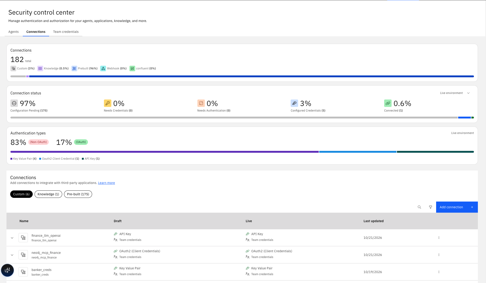
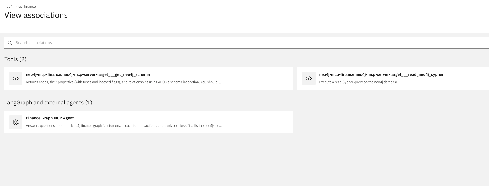
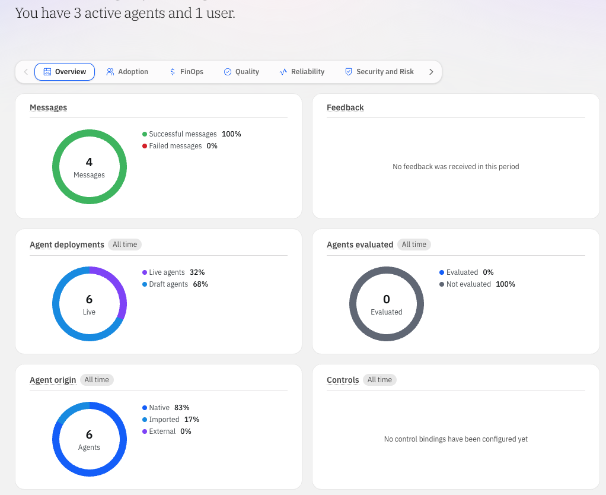
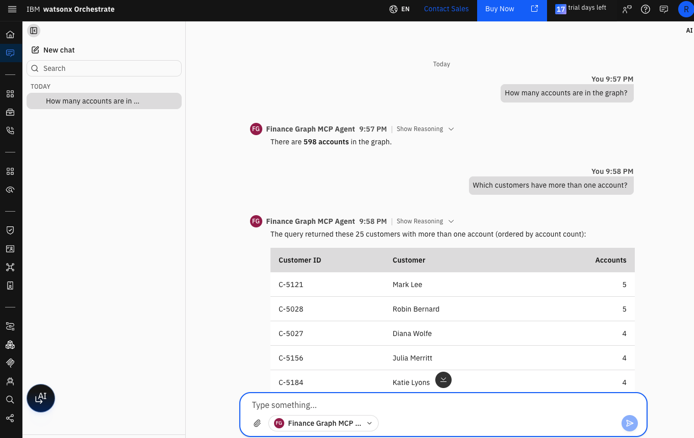

# Neo4j integration with watsonx Orchestrate through MCP



The top row shows the request path. A question in Orchestrate chat reaches the
LangGraph agent, which calls the AWS AgentCore gateway over MCP, and the
gateway reaches the Neo4j finance MCP server and its Aura graph. The lower rows
show what the graph adds. The agent reads the schema, retrieves connected
entities with Cypher traversals, and answers from the result rows.

This example integrates Neo4j into **watsonx Orchestrate** through the Model
Context Protocol. It connects the Neo4j finance MCP server to Orchestrate as an
**MCP toolkit**, then builds a small LangGraph agent on top of it.

The integration has two halves. On the Neo4j side, the finance MCP server runs
behind an AWS AgentCore gateway and exposes two tools, one for the graph schema
and one for read-only Cypher. The gateway is protected by a Cognito OAuth client
credentials flow. On the Orchestrate side, a **managed connection** holds those
credentials so Orchestrate can fetch tokens when it calls the gateway, and the
**MCP toolkit** registers the server's tools for agents to use. Once both
exist, any Orchestrate agent can query the graph, and no tool is written for
each question.

## Business value

This example shows one way Neo4j integrates with **watsonx Orchestrate**.
Orchestrate gives a bank the **agent builder**, the **chat** interface, and the
governance around **managed connections** and **deployment**. Neo4j gives those
agents a connected view of the bank's data. The **MCP toolkit** joins the two:

- **New questions need no new tools.** The agent reads the graph schema and
  writes read-only Cypher. A question nobody planned for gets an answer
  without a developer writing and importing another tool.
- **Answers come from relationships.** Counts by product, customers with
  several accounts, and accounts with no product are all graph queries. A text
  index cannot answer them.
- **The graph stays read-only.** The gateway exposes two tools, one for the
  schema and one for read-only Cypher. Nothing in the demo can change the data.
- **Credentials stay out of the agent.** The OAuth client secret lives in an
  Orchestrate connection. Orchestrate fetches the token and injects it, so the
  agent code holds no secret.
- **Governance stays in Orchestrate.** The connection is managed, has separate
  draft and live values, and lists the tools and agents that use it.
- **One server serves many agents.** Any Orchestrate agent can use the same
  toolkit, including the LangGraph agent built here, which runs in
  Orchestrate's own runtime.

## What is here

| File | Purpose |
|---|---|
| `create_mcp_connection.sh` | Creates the `neo4j_mcp_finance` connection from `.mcp-credentials.finance.json` |
| `finance-agent/` | The LangGraph agent package: `agent.py`, `agent.yaml`, `requirements.txt` |
| `deploy_finance_agent.sh` | Creates the LLM connection, imports the agent, and connects both connections to it |
| `run_local.py` | Runs the agent on your machine against the real gateway |

## Prerequisites

- The `orchestrate` CLI, logged in to the target environment
- `jq` and `uv`
- `.mcp-credentials.finance.json` in the `graphrag-banking` directory. The file
  is git-ignored and holds `gateway_url`, `token_url`, `client_id`,
  `client_secret` and `scope`.
- `OPENAI_API_KEY` in `.env`

## 1. Create the connection

```bash
./mcp-setup/create_mcp_connection.sh
```

This creates an `oauth_auth_client_credentials_flow` connection named
`neo4j_mcp_finance` with `--type team`, so the credentials apply to all users.
The same values are set for `draft` (preview chat) and `live` (deployed agent).
The script is safe to re-run. It updates the values in place.

Check it with `orchestrate connections list`. In the UI, the connection appears
under Security control center, then Connections.



## 2. Register the MCP server

In the Orchestrate UI, open Register MCP server and fill in:

| Field | Value |
|---|---|
| Server name | `neo4j-mcp-finance` |
| Transport type | Streamable HTTP |
| MCP server URL | `gateway_url` from `.mcp-credentials.finance.json` |
| Connection | `neo4j_mcp_finance` |
| Description | Neo4j finance MCP server: schema and read-only Cypher tools |

Or use the CLI:

```bash
orchestrate toolkits add --kind mcp --name neo4j-mcp-finance \
  --description "Neo4j finance MCP server: schema and read-only Cypher tools" \
  --url "$(jq -r .gateway_url .mcp-credentials.finance.json)" \
  --transport streamable_http --tools "*" --app-id neo4j_mcp_finance
```

The server exposes two tools:

- `neo4j-mcp-server-target___get_neo4j_schema`
- `neo4j-mcp-server-target___read_neo4j_cypher`

## How the stdio server works

The tenant already has a second toolkit, `neo4j_local_mcp`. It is a stdio MCP
server, which is a different kind of server from the finance gateway.

A stdio server is a program, not a URL. Orchestrate starts the program and
exchanges MCP messages with it over the program's standard input and output.
There is no network endpoint, which is why the MCP servers page shows `N/A` in
the URL column.

`orchestrate toolkits list -v` shows how this one is launched:

```json
"mcp": {
  "tools": ["*"],
  "connections": { "neo4j_local_creds": "..." },
  "source": "public-registry",
  "command": "uvx",
  "args": ["--from", "neo4j-mcp-server", "python", "-m", "neo4j_mcp_server"]
}
```

- `command` and `args` start the `neo4j-mcp-server` package from the registry
  with `uvx`.
- `connections` names `neo4j_local_creds`. It is a key/value connection, and
  its entries are the settings the server process needs to reach Neo4j.
- `tools: ["*"]` imports every tool the server lists.

The two kinds of server compare as follows.

| | `neo4j_local_mcp` | `neo4j-mcp-finance` |
|---|---|---|
| Transport | stdio | Streamable HTTP |
| Where it runs | A process that Orchestrate launches | AWS AgentCore gateway |
| Address | None | `gateway_url` |
| Connection kind | key/value, passed to the process | OAuth2 client credentials, sent as a bearer token |
| Tools | 3 | 2 |

## Verify the finance server

Run these from the `graphrag-banking` directory.

**1. Check the toolkit and tools in Orchestrate.**

```bash
orchestrate toolkits list -v        # neo4j-mcp-finance, with connection neo4j_mcp_finance
orchestrate tools list | grep neo4j # the two gateway tools, tied to neo4j_mcp_finance
```

In the UI, open the connection and choose View associations. It lists the two
tools and any agent that uses the connection.



**2. Call the gateway directly.** This checks the credentials and the gateway
without Orchestrate. A token is fetched with the client credentials grant, then
`tools/list` and `tools/call` run against the gateway.

```bash
f=.mcp-credentials.finance.json
TOKEN=$(curl -s -X POST "$(jq -r .token_url $f)" \
  -u "$(jq -r .client_id $f):$(jq -r .client_secret $f)" \
  -d grant_type=client_credentials \
  --data-urlencode "scope=$(jq -r .scope $f)" | jq -r .access_token)
call() {
  curl -s -X POST "$(jq -r .gateway_url $f)" \
    -H "Authorization: Bearer $TOKEN" \
    -H "Content-Type: application/json" \
    -H "Accept: application/json, text/event-stream" -d "$1"
}

call '{"jsonrpc":"2.0","id":1,"method":"tools/list"}' | jq -r '.result.tools[].name'
call '{"jsonrpc":"2.0","id":2,"method":"tools/call","params":{"name":"neo4j-mcp-server-target___get_neo4j_schema","arguments":{}}}' | head -c 400
```

A working setup lists both tools, and the schema call returns the node labels
with their counts, such as `Policy` with 12 nodes.

**3. Run a tool from the UI.** On the MCP servers page, the play button next to
a server runs one of its tools.

## 3. The LangGraph agent

`finance-agent/` is a LangGraph agent that answers questions about the finance
graph through the MCP server. Orchestrate runs it in its own runtime, so no
server of yours is involved.

### How it works

The graph has four nodes.

```
prepare -> agent -> tools -> agent -> ... -> respond
```

- `prepare` seeds the turn with a system prompt and the user's question.
- `agent` is an OpenAI model with the MCP tools bound. It decides whether to
  call the schema tool, the Cypher tool, or answer.
- `tools` runs the tool calls against the gateway and feeds the results back to
  `agent`. The loop stops after 6 tool rounds.
- `respond` writes one plain assistant message to the chat.

The state has two message lists. `working` holds the LLM and tool history for
the turn. `messages` is what Orchestrate sees, and only `respond` writes to it.
This keeps tool messages out of the platform's response layer.

The tools come from `langchain-mcp-adapters`. The node connects to the gateway
over Streamable HTTP, lists the tools, and wraps them as LangChain tools.

### Credentials

Orchestrate injects connection credentials into the factory function's config.
The keys follow the pattern `{app_id}_{credential_type}`. For the OAuth
connection, Orchestrate fetches the Cognito token itself and injects the result,
so the agent holds no client secret.

| Key | Source |
|---|---|
| `finance_llm_openai_api_key` | `finance_llm_openai` connection, an API key connection holding `OPENAI_API_KEY` |
| `neo4j_mcp_finance_access_token` | `neo4j_mcp_finance` connection, fetched by Orchestrate |
| `neo4j_mcp_finance_token_type` | `neo4j_mcp_finance` connection, normally `Bearer` |
| `neo4j_mcp_finance_url` | `neo4j_mcp_finance` connection, the gateway URL |

### Run it locally

```bash
uv run --with langchain-mcp-adapters python mcp-setup/run_local.py \
  "How many accounts are in the graph?"
```

`run_local.py` builds the same credentials dict that Orchestrate injects. It
fetches a token from Cognito and reads `OPENAI_API_KEY` from `.env`. The
dependency is added with `--with`, so `pyproject.toml` stays unchanged.

### Register it in Orchestrate

```bash
./mcp-setup/deploy_finance_agent.sh
```

The script does four things:

1. Creates the `finance_llm_openai` API key connection for draft and live.
2. Runs `orchestrate agents import --package-root mcp-setup/finance-agent`.
3. Runs `orchestrate agents connect` to attach `finance_llm_openai` and
   `neo4j_mcp_finance` to `finance_graph_agent`.
4. Runs `orchestrate agents deploy --name finance_graph_agent`.

`agents import` creates a draft only. The Chat agent picker lists deployed
agents only, so the agent does not appear there until the deploy step runs.
`orchestrate chat ask -n finance_graph_agent` reaches drafts, so it works
before the deploy.

The script is safe to re-run. After it runs, the agent also shows under View
associations for `neo4j_mcp_finance`.

The agents overview in Orchestrate shows the agents on the tenant after the
deploy, with live and draft agents counted separately.



### Test it in Orchestrate

```bash
orchestrate chat ask -n finance_graph_agent \
  "Which account products exist and how many accounts use each one?" </dev/null
```

Close stdin with `</dev/null`. After the first answer, `chat ask` waits for a
second message and loops on `EOF when reading a line` when no terminal is
attached. The answer is in the first reply box.

Test results from this setup:

| Question | Answer |
|---|---|
| How many accounts are in the graph? | 598 accounts |
| Which account products exist and how many accounts use each one? | Standard Checking 211, Standard Savings 92, Premium Checking 47 |
| Which customers have more than one account? | A table of 25 customers with their IDs and account counts. Mark Lee (C-5121) and Robin Bernard (C-5028) lead with 5 accounts each. |

The agent's system prompt caps queries at `LIMIT 25`, so a long list can come back truncated at 25 rows.

The product counts add up to 350. The other 248 accounts have no product. A
local run of the same agent confirmed that split when asked to include accounts
with no product.

### Ask it in Chat

After the deploy step, pick Finance Graph MCP Agent in the Chat agent picker.
These questions work well, since the agent reads the schema and runs read-only
Cypher:

- How many accounts are in the graph?
- Which customers have more than one account?
- Which account products exist and how many accounts use each one?
- Which accounts have no product assigned?
- What node labels and relationships are in the graph?



### Ask it to find fraud

The graph holds the signals that fraud rings leave behind: shared phones,
devices and addresses, groups of connected entities, circular transfers, and
compliance alerts. These questions send the agent after them. The Cypher
behind each one was run against the graph, and the note says what it should
find.

**Shared identifiers across loan applicants**

- Which devices were used to submit loan applications for more than one
  business, and which businesses are they?
  *`DEV-1001` was used by Ortega Builders, Keystone Paving and Summit Ridge
  Supply.*
- Which phone numbers are shared by more than one business or person?
  *`+1-555-0610` belongs to Victor Hale and four businesses.*
- Which addresses are shared by the most businesses, and what kind of address
  is each one?
  *Delaware registered-agent addresses and Illinois and Wisconsin coworking
  spaces lead the list.*

**Connected groups and ownership**

- What are the largest connected groups, and which people and businesses are in
  them?
  *`CG-0001` has 11 members, including Victor Hale, Luis Ortega, Crestline
  Holdings and Hale Restoration LLC.*
- Which people own or direct more than one business in the same connected group?
- Which businesses applied for a loan within a year of being registered, and
  for how much?
  *Cook-Phillips, registered 2025-08-24, has a 454,000 application in review.*

**Money movement**

- Which pairs of accounts send money back and forth to each other?
  *Accounts `A-3001` and `A-3002` move 40,000 to 85,000 between them in both
  directions.*
- Which accounts made more than one outgoing wire to a payee they had never paid
  before?
- Which accounts have several transactions between 9,000 and 10,000, just under
  a reporting threshold?

**Alerts and policy**

- Which compliance alerts are still open or escalated, and which transaction
  raised each one?
  *Alerts such as `AL-5000` and `AL-5021` are escalated wire reviews.*
- How many alerts were raised under each compliance rule, split by status?
- Which loan applications in review connect to a business that shares a device,
  phone or address with another applicant?

A follow-up such as "Show me the people and businesses behind that device" lets
the agent walk the graph one more hop from its last answer. The agent prompt
caps each query at `LIMIT 25`, so ask for the top results when a list is long.

## Troubleshooting

| Symptom | Cause and fix |
|---|---|
| `Your agent configuration appears to be invalid` and `No gateway credential. Keys present: [...]` | The agent read a credential key that Orchestrate did not inject. Compare the listed keys with the table in the Credentials section. The error lists key names only, never values. |
| OpenAI 400 about `reasoning_effort` and function tools | The model does not accept function tools on chat completions. `agent.py` sets `use_responses_api=True` to avoid this. |
| `chat ask` prints `EOF when reading a line` forever | Close stdin with `</dev/null`, or run `chat ask` without a message in a terminal. |
| The agent is missing from the Chat picker | The agent is still a draft. Run `orchestrate agents deploy --name finance_graph_agent` and refresh the page. |
| The Connection dropdown does not list `neo4j_mcp_finance` | Reload the page. Confirm the connection with `orchestrate connections list`. |

## Notes

- The `access_token` stored in the credentials file expires. Nothing here uses
  it. Orchestrate and `run_local.py` fetch their own tokens.
- If the Cognito client secret is rotated, update `.mcp-credentials.finance.json`
  and re-run `create_mcp_connection.sh`.
- The model name lives in `LLM_MODEL` in `finance-agent/agent.py`. Change it
  there and re-run `deploy_finance_agent.sh`.
