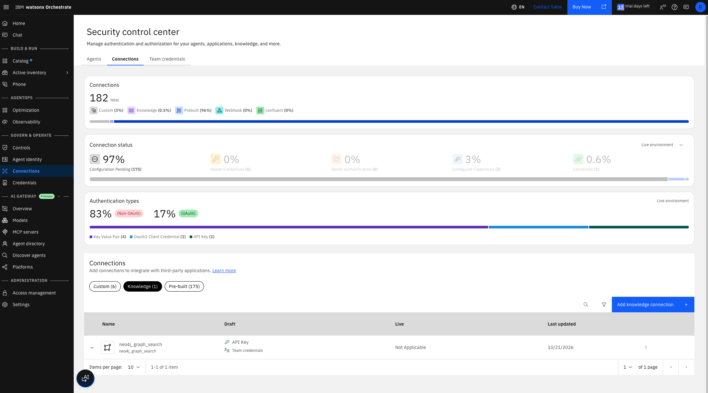
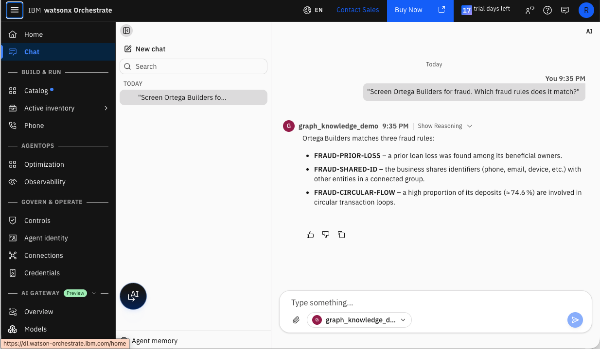

# Custom knowledge service

This service lets watsonx Orchestrate use the Neo4j graph as a knowledge source. An Orchestrate agent asks the service a question over HTTPS. The service searches the graph and returns passages, and the agent answers from them.

## Overview

### What the service is

The service is a small FastAPI app, `app.py`. It follows the request and response format of the Orchestrate [Custom service](https://www.ibm.com/docs/en/watsonx/watson-orchestrate/base?topic=search-custom-service-integration-setup) knowledge source. It runs on AWS Lambda behind a Function URL, and it adds no Cypher of its own. It calls functions that already exist in this repo, and both are read-only.

```
Orchestrate agent                     AWS Lambda                         Neo4j
graph_knowledge_demo  --POST, key-->  app.py (FastAPI + Mangum)  ------>  policy chunks,
(neo4j_graph_knowledge)  <-results--  search_policies, screen_business    businesses, fraud rules
```

### What Orchestrate sends and gets back

Orchestrate sends `POST <server_url>` with this body:

```json
{"query": "<QUERY>", "filter": "<FILTER>", "metadata": {}}
```

`filter` and `metadata` are optional. The service answers with:

```json
{"search_results": [
  {"title": "...", "body": "...", "result_metadata": {"score": 0.91, "rule_codes": ["..."]}}
]}
```

The service answers on `/` and on `/query`, because Orchestrate posts to the server URL exactly as entered.

### How the service builds an answer

1. **Fraud screen:** When `filter` is a business name, the service runs `find_my_client` and `screen_business` from `src/graphrag_banking/staff_tools.py` for the banker in `DEMO_BANKER_ID`. Each check returns one result. A business in another banker's book returns its name and banker only.
2. **Policy passages:** The service runs `search_policies` from `src/graphrag_banking/tools.py` on the query. Each result is a policy section with its score and rule codes.

Orchestrate keeps only the first 5 snippets of `search_results`, so the order matters. The service returns at most 5 results. Every fraud screen result comes first and always stays, even when there are more than 5. The policy passages fill the remaining slots in score order. With no `filter`, the response holds the top 5 policy passages.

### What you end up with

| Piece | Where it lives | Made by |
|---|---|---|
| The graph | Neo4j Aura | `make rebuild` |
| The service | A Lambda function and its Function URL | `deploy_lambda.sh` |
| A shared key | `.env`, the Lambda, and the Orchestrate connection | `deploy_lambda.sh` and `upload_to_orchestrate.sh` |
| A connection | Orchestrate, named `neo4j_graph_search` | `upload_to_orchestrate.sh` |
| A knowledge base | Orchestrate, named `neo4j_graph_knowledge` | `upload_to_orchestrate.sh` |
| A test agent | Orchestrate, named `graph_knowledge_demo` | `upload_to_orchestrate.sh` |

## Setup at a glance

You need `uv`, the AWS CLI with a default profile, the [Neo4j CLI](https://neo4j.com/docs/neo4j-cli/), and the `orchestrate` CLI logged in to your tenant. Run every command from the `graphrag-banking` folder.

| Step | Command | Details |
|---|---|---|
| 1. Build the graph | `make rebuild` | The service fails on an empty graph |
| 2. Check `.env` | `neo4j-cli query --env .env 'RETURN 1 AS ok' --format toon` | [Check the settings](#1-check-the-settings) |
| 3. Build the zip | `./orchestrate/custom_knowledge_service/build_lambda.sh` | [Host it on AWS Lambda](#3-host-it-on-aws-lambda) |
| 4. Deploy | `./orchestrate/custom_knowledge_service/deploy_lambda.sh` | It prints the Function URL |
| 5. Test the URL | `curl` with the key, as shown in [Test the URL](#test-the-url) | Results here mean the service works |
| 6. Upload to Orchestrate | `./orchestrate/custom_knowledge_service/upload_to_orchestrate.sh` | [Connect it to Orchestrate](#4-connect-it-to-orchestrate) |
| 7. Ask in Chat | Pick `graph_knowledge_demo` and ask about Ortega Builders | [Test it in Chat](#5-test-it-in-chat) |

Step 6 can instead be done by hand in the dashboard. The details are in [Option 2](#option-2-use-the-dashboard).

## 1. Check the settings

Before you deploy, confirm that `.env` reaches the graph and that the graph holds data:

```bash
neo4j-cli query --env .env 'RETURN 1 AS ok' --format toon
neo4j-cli query --env .env \
  'MATCH (n) RETURN labels(n)[0] AS label, count(*) AS n ORDER BY n DESC' --format toon
neo4j-cli query --env .env \
  "SHOW VECTOR INDEXES YIELD name, state RETURN name, state" --format toon
```

The first command proves the connection settings. The second must list `Document`, `Chunk`, and the banking nodes. The third must list `chunk_embedding` as `ONLINE`. An empty second result means the graph is not built, and every policy query fails with `IndexNotFound 'chunk_embedding'`. Run `make rebuild` to build it.

## 2. Run it locally

This step is optional. It proves the service works before you deploy it. Run:

```bash
export KNOWLEDGE_SERVICE_API_KEY=$(openssl rand -hex 16)
uv run --with fastapi --with uvicorn uvicorn app:app \
  --app-dir orchestrate/custom_knowledge_service --port 8099
```

Call it from a second terminal:

```bash
curl -s -X POST http://127.0.0.1:8099/query \
  -H "x-api-key: $KNOWLEDGE_SERVICE_API_KEY" \
  -H "content-type: application/json" \
  -d '{"query": "wire transfer fee", "filter": "Ortega"}'
```

## 3. Host it on AWS Lambda

Lambda suits this demo. It costs almost nothing for a short trial, and it gives a stable HTTPS URL with no server to keep running. The pieces are:

| Piece | Role |
|---|---|
| `lambda_handler.py` | Mangum wraps the FastAPI app, so one `handler` serves Function URL events |
| `requirements-lambda.txt` | The packages the zip needs. It adds Mangum and drops Uvicorn |
| `build_lambda.sh` | Builds `orchestrate/build/knowledge_service.zip` for `python3.13` on `arm64` |
| `deploy_lambda.sh` | Creates the role, the function, and the Function URL, or updates them |

### Build

The script downloads Linux arm64 wheels, so it works from a Mac:

```bash
./orchestrate/custom_knowledge_service/build_lambda.sh
```

The zip is about 8 MB, well under the 50 MB limit for a direct upload.

### Deploy

Deploying creates a public URL in your AWS account. Deploy only when you are ready to connect Orchestrate, and delete it afterward.

```bash
./orchestrate/custom_knowledge_service/deploy_lambda.sh
```

The script uses your default AWS profile. Set `AWS_PROFILE` to use another one. It copies the Neo4j, OpenAI, and demo settings from `.env` into the function's environment, adds the shared key from `.env`, and prints the Function URL. It prints no secret. Run it again after a code change and it updates the function.

The function uses 512 MB and a 30 second timeout. A cold start opens the Neo4j driver and takes a few seconds. After the first call the function stays warm for a while.

### Test the URL

```bash
URL=<the Function URL>
KNOWLEDGE_SERVICE_API_KEY=$(sed -n 's/^KNOWLEDGE_SERVICE_API_KEY=//p' .env)
curl -s -X POST "$URL" -H "content-type: application/json" \
  -d '{"query": "wire transfer fee"}'                        # 401
curl -s -X POST "$URL" -H "content-type: application/json" \
  -H "x-api-key: $KNOWLEDGE_SERVICE_API_KEY" \
  -d '{"query": "wire transfer fee", "filter": "Ortega"}'    # search_results
```

The first call must return a 401. The second must return five results, with three Ortega Builders fraud screens first.

## 4. Connect it to Orchestrate

Connect it after the service is deployed and `curl` returns results. There are two ways to do it. Both end with the same three things: a connection, a knowledge source, and an agent that uses the source.

A Custom service knowledge connection takes a server URL and one of Basic, API key, or no authentication. Choose API key. A connection cannot be renamed or deleted once it is created, so pick the names you want first.

### Option 1: run the script

The script creates the connection, the knowledge base, and a test agent, `graph_knowledge_demo`. It also deploys the agent. An import makes only a draft, and the Chat page lists deployed agents only.

```bash
./orchestrate/custom_knowledge_service/upload_to_orchestrate.sh
```

It reads the service URL from `KNOWLEDGE_SERVICE_URL` in `.env`, and falls back to the Function URL of the Lambda in your default AWS profile. It reads the shared key from `.env` only when it has to create the connection. The script leaves an existing `neo4j_graph_search` connection alone, so a connection made in the dashboard is reused. Run the script again after a change and it updates what it made.

Two settings change what it uploads:

| Variable | Use |
|---|---|
| `KNOWLEDGE_SERVICE_URL` | The service URL, when it is not the Lambda Function URL |
| `KNOWLEDGE_FILTER` | The business name the service screens on every search. The default is `Ortega` |

The script never deletes a knowledge source. If you already made a source in the dashboard, it stays next to the one the script makes. Both use the same connection, so they do not conflict. Remove the one you do not want with `orchestrate knowledge-bases remove -n <name>`. This deletes only the Orchestrate entry. The connection and the Lambda stay. Run `orchestrate knowledge-bases list` to see the names.

### Option 2: use the dashboard

1. Open **Build > Knowledge** and add a knowledge source. Choose **Custom service**.
2. Create a connection. Enter the service URL, choose **API key**, set the key name to `x-api-key`, and choose **Team credentials**. Paste the value of `KNOWLEDGE_SERVICE_API_KEY` from `.env` into the key field. The connection shows **Connected** when it works.

   

   The connection as it appears under **Connections > Knowledge** in the Security control center.
3. Leave **Default filter** and **Metadata** empty to get policy passages only. Enter a business name such as `Ortega` in **Default filter** to add the fraud screens for that business to every search.
4. Enter a name and a description on the **Knowledge details** step. Agents read the description to decide when to call the source, so name the topics the graph covers. The description in `knowledge_base.yaml` works as is.
5. Open an agent, go to **Knowledge**, and add the source.

A source made in the dashboard gets a random suffix on its name, such as `neo4j_graph_search_3844uo`. Run `orchestrate knowledge-bases list` to see the exact name.

## 5. Test it in Chat

Open **Chat** and pick `graph_knowledge_demo` from the agent picker. If the agent is missing from the picker, it is still a draft. Deploy it, then refresh the page:

```bash
orchestrate agents deploy --name graph_knowledge_demo
```

Draft agents show only in the preview chat on the **Build** page. `orchestrate chat ask` does not work from a script or an agent session. It is interactive and fails with `EOF when reading a line`, so test in the dashboard.

Ask these questions:

| Question | What it shows |
|---|---|
| What is the wire transfer fee? | Policy passages from the graph |
| Screen Ortega Builders for fraud. | The fraud screens, which come from a graph traversal. This works when the filter is `Ortega` |
| Which fraud rules does Ortega Builders match? | Rule codes and connected accounts in the answer |

With the filter set to `Ortega`, the agent answers the fraud question from the graph:



The answer names three rules: `FRAUD-PRIOR-LOSS`, `FRAUD-SHARED-ID`, and `FRAUD-CIRCULAR-FLOW`. The agent has no tools, so these came from the fraud screen the service ran in Neo4j.

### If the agent answers "I don't know"

Check the three parts in order:

1. **The service:** Call it with `curl`, as in [Test the URL](#test-the-url). No results here means the problem is in the service.
2. **The connection:** Run `orchestrate connections list` and confirm `neo4j_graph_search` shows a credential. A missing credential means the key was never set.
3. **The logs:** Run `aws logs tail /aws/lambda/neo4j-knowledge-service --since 10m`. A request that reached the service shows a `START` and a `REPORT` line. No line means Orchestrate never called it.

The `REPORT` line shows the duration. A real search takes 2 to 8 seconds, because it embeds the query and reads the graph. A request that the key check rejects takes about 10 milliseconds. A cold start adds about 1.5 seconds. The service logs no headers and no key, so the logs show that a request was accepted but not which key header carried it.

## Reference

### Settings

The service reads the same `.env` variables as the rest of the repo, plus one key.

| Variable | Use |
|---|---|
| `NEO4J_URI`, `NEO4J_USERNAME`, `NEO4J_PASSWORD`, `NEO4J_DATABASE` | The graph |
| `OPENAI_API_KEY`, `OPENAI_EMBEDDING_MODEL` | Embeds the query for policy search |
| `DEMO_BANKER_ID` | The banker whose book the fraud screen reads |
| `KNOWLEDGE_SERVICE_API_KEY` | The shared key every request must send |

The service refuses to start when `KNOWLEDGE_SERVICE_API_KEY` is empty.

### The API key

The service has one shared key, `KNOWLEDGE_SERVICE_API_KEY`. Orchestrate sends it with every request, and the service rejects any request without it. A request passes when the key arrives as an `X-API-Key` header, as `Authorization: Bearer <key>`, or as the password of a Basic login. Any other request gets a 401. The IBM documentation does not name the header Orchestrate sends, so the service accepts all three.

The key lives in `.env`, which git ignores. `deploy_lambda.sh` reads it from there. When `.env` has no key, the script generates one with `openssl rand -hex 16` and appends it to `.env`. To generate one yourself, add this line to `.env`:

```bash
KNOWLEDGE_SERVICE_API_KEY=<a long random value>
```

The same value goes in two places: the Lambda's environment, which `deploy_lambda.sh` sets, and the Orchestrate connection, which `upload_to_orchestrate.sh` sets or you set by hand. To rotate the key, change it in `.env`, deploy again, and update the connection.

### Security

- **A public URL:** Orchestrate cannot sign requests with AWS credentials, so the Function URL has no AWS authentication. The shared key is the only protection. Use a long random key.
- **Secrets in the environment:** Anyone with `lambda:GetFunctionConfiguration` on the function can read the Neo4j and OpenAI settings. For more than a short demo, move them to Secrets Manager.
- **Read-only graph access:** The service only reads, but it uses the `.env` Neo4j user. Create a read-only Neo4j user for the function if your instance supports it.

### Notes

- **Fixed filter:** The filter is one value for every search, so the test agent screens one business. The ADK `input_schema` setting may let the agent fill the filter from the question. This has not been tested.
- **Built-in documents:** A knowledge base made by this script has no uploaded documents. The built-in vector index is empty, and every result comes from the service.
- **The ADK:** The script uses a `custom_search` index, described in [Creating knowledge bases](https://developer.watson-orchestrate.ibm.com/knowledge_base/build_kb).

### Build the container image

Lambda needs no image. Build one to run the service somewhere else, such as a container host. Build from the `graphrag-banking` folder, so the image can copy `src/`:

```bash
docker build -f orchestrate/custom_knowledge_service/Dockerfile -t neo4j-knowledge-service .
docker run -p 8080:8080 --env-file .env \
  -e KNOWLEDGE_SERVICE_API_KEY=$KNOWLEDGE_SERVICE_API_KEY neo4j-knowledge-service
```

The image copies no `.env` file. Pass the settings as environment variables.

### Remove it

Remove the Orchestrate parts, then the Lambda:

```bash
orchestrate agents remove --name graph_knowledge_demo --kind native
orchestrate knowledge-bases remove -n neo4j_graph_knowledge
aws lambda delete-function-url-config --function-name neo4j-knowledge-service
aws lambda delete-function --function-name neo4j-knowledge-service
aws iam detach-role-policy --role-name neo4j-knowledge-service-role \
  --policy-arn arn:aws:iam::aws:policy/service-role/AWSLambdaBasicExecutionRole
aws iam delete-role --role-name neo4j-knowledge-service-role
```

The `neo4j_graph_search` connection stays, because Orchestrate does not delete knowledge connections.

### Files

| File | Role |
|---|---|
| `app.py` | The FastAPI service |
| `requirements.txt` | The image's Python packages |
| `Dockerfile` | Builds the image |
| `lambda_handler.py` | The Lambda entry point |
| `requirements-lambda.txt` | The Lambda zip's Python packages |
| `build_lambda.sh` | Builds the Lambda zip |
| `deploy_lambda.sh` | Creates or updates the function and its URL |
| `knowledge_base.yaml` | The Orchestrate knowledge base, with `__URL__` and `__FILTER__` filled in at upload |
| `demo_agent.yaml` | The `graph_knowledge_demo` test agent |
| `upload_to_orchestrate.sh` | Creates the connection if needed, then imports the knowledge base, imports the agent, and deploys it |
| `knowledge_connection.png` | Screenshot of the connection in the dashboard |
| `chat_one.png` | Screenshot of the agent answering in Chat |
