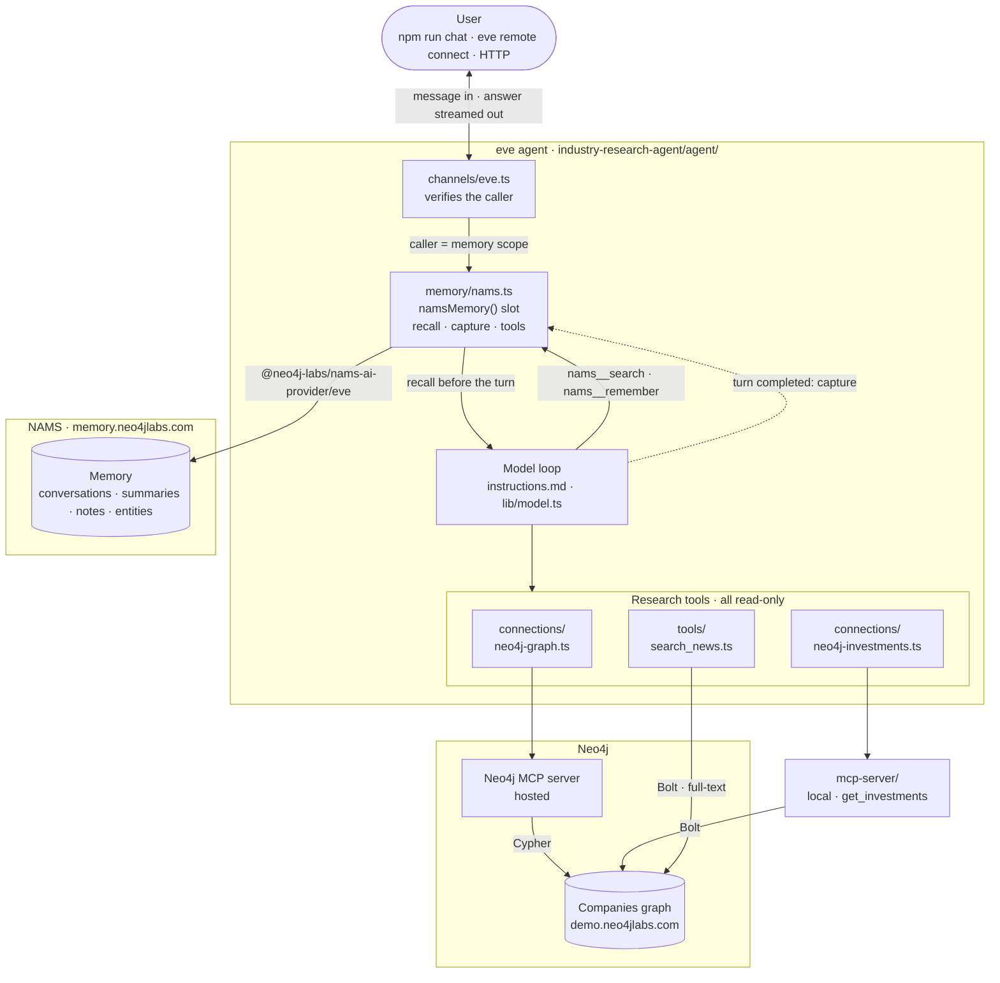
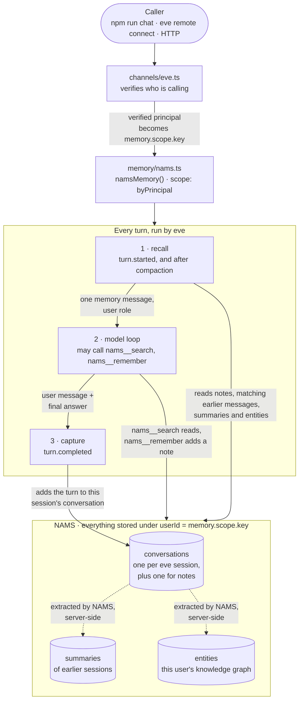

# Vercel eve + Neo4j: an agent that remembers you

An AI agent that answers questions about companies from a Neo4j graph, and
remembers each user between sessions.

Close the terminal. Come back tomorrow. It still knows your name and what you
research, because none of that lived in the session. It lived in NAMS, a memory
service built on a Neo4j graph.

**The working project is in [`industry-research-agent/`](industry-research-agent/).**

---

## The three pieces

**eve** is Vercel's framework for backend AI agents. You write your agent as
files in an `agent/` folder — instructions, tools, memory — and eve runs them.
A file's folder decides what it does. There is no registry to update and
nothing to import.

**Neo4j** is a graph database. It stores things (a company, a person, an
article) and the links between them, instead of rows in tables. You query it
with a language called Cypher.

**NAMS** (Neo4j Agent Memory, [memory.neo4jlabs.com](https://memory.neo4jlabs.com))
is a hosted memory service built on Neo4j. This agent uses it through one
package, [`@neo4j-labs/nams-ai-provider`](https://www.npmjs.com/package/@neo4j-labs/nams-ai-provider),
whose `/eve` entry point plugs NAMS into an eve **memory slot**. (This agent
uses provider 0.5.0, whose `/eve` entry point needs eve 0.84.0 or later.)
NAMS keeps:

| Kind | What it holds |
|---|---|
| conversations | each session's exchanges, one NAMS conversation per eve session |
| summaries | what NAMS wrote about each earlier session |
| notes | short facts the model saved with `nams__remember` |
| entities | people, companies and topics NAMS extracts from the conversations, kept per user |

Together: eve runs the agent, NAMS remembers the user, Neo4j is the database
underneath both.

---

## Architecture



Read it top to bottom as one turn:

1. The message arrives through `channels/eve.ts`, which decides who the caller
   is. eve turns that caller into the memory slot's scope.
2. Before the model runs, the slot recalls this user's notes, summaries of their
   earlier sessions, matching earlier messages, and matching entities from their
   knowledge graph, and adds them as one memory message.
3. The model answers, calling research tools as it chooses — all read-only — and
   the slot's `nams__search` / `nams__remember` if it needs them.
4. When the turn ends, the slot saves the exchange to NAMS.

`agent/memory/nams.ts` is the **only** memory code in the project. eve runs
recall and capture on every turn, whatever the model decides.
[How memory works](#how-memory-works) has the details.

---

## Why bother? A session is not memory

eve keeps a conversation alive for a long time, but that is still just one
conversation. eve's own docs say session state dies with the session, and point
you at an external store for anything that should outlive it.

eve's memory providers today are File memory (one document per scope),
Supermemory and Kybernesis Arcana (semantic search), and Upstash AgentKit
(Redis search). None of them stores memory as a graph.

A graph matters here because the things worth remembering are connected. This
user follows these sectors, which contain these companies, which compete with
those companies, which appear in these articles. NAMS keeps the entities it
extracts from each conversation in a Neo4j graph, with the relationships it
finds between them. The slot recalls the user's matching entities by name and
description; their relationships stay in the graph, where you can query them or
browse them in the NAMS dashboard.

---

## What you need

| | |
|---|---|
| **Node 24+** | check with `node -v` |
| **A NAMS API key** | free at [memory.neo4jlabs.com](https://memory.neo4jlabs.com) |
| **A model key** | `OPENAI_API_KEY`, or `AI_GATEWAY_API_KEY` for Vercel AI Gateway |
| **Neo4j** | nothing to set up — it uses a public read-only demo database |

> **Use a fresh NAMS workspace for a demo.** Each user's memory is kept apart,
> so a shared workspace doesn't leak one user's memory into another's recall.
> But the NAMS dashboard shows the whole workspace, and older entities saved
> without a user show up there too.

---

## Setup

```bash
cd industry-research-agent
npm install
cp .env.example .env
```

`npm install` takes `@neo4j-labs/nams-ai-provider` 0.5.0 and
`@neo4j-labs/agent-memory` 0.6.0 from npm, with eve 0.91.

Open `.env` and fill in two lines:

```env
NAMS_API_KEY=nams_...
OPENAI_API_KEY=sk-...
```

Everything else has a working default. The `NEO4J_*` lines already point at the
public demo graph — leave them alone.

Check it compiled:

```bash
npx eve info        # expect: 0 errors, 1 skill, 7 tools
```

---

## Run it

### Chat in your terminal

```bash
npm run chat
```

This starts the local MCP server (see below) and opens eve's chat UI. Type a
question. Ctrl+C to quit.

Try these:

```
What's been written about graph database funding?
Who are the investors in Neo4j?
What node labels does this graph have?
```

### One question at a time, no UI

Start the dev server without its UI, then send questions from another terminal:

```bash
npx eve dev --no-ui                     # terminal 1: serves http://127.0.0.1:2000
npx eve remote connect --url http://127.0.0.1:2000 --print "Who are the investors in Neo4j?"
```

`--print` sends one message, prints the final answer, and exits. Useful in
scripts and for testing. Each call is a **separate session**. To keep talking
in one session, leave out `--print`: `eve remote connect` then opens the chat
UI against that server.

There is no plain `eve invoke`. If port 2000 is taken, eve picks the next free
one and prints it.

### Over HTTP

`npx eve dev` serves on `http://127.0.0.1:2000`:

```bash
curl -X POST http://127.0.0.1:2000/eve/v1/session \
  -H 'content-type: application/json' \
  -d '{"message":"Who has invested in Neo4j?"}'
# {"ok":true,"sessionId":"wrun_...","deliveryId":"..."}

curl -N http://127.0.0.1:2000/eve/v1/session/<sessionId>/stream
```

No auth header needed locally.

---

## See the memory work

With `npx eve dev --no-ui` running, send these one after the other:

```bash
npx eve remote connect --url http://127.0.0.1:2000 --print "Remember this: my name is Alex and I cover the graph database sector."
npx eve remote connect --url http://127.0.0.1:2000 --print "What is my name and what sector do I cover?"
```

The second one knows.

That is the whole point, so it's worth being clear about why it works. Each
`--print` call is a separate session — the second command cannot see the
first one's chat history. The only path between them is NAMS: the model saved
a note with `nams__remember`, the slot captured the exchange after the turn,
and the slot recalled both before the second session's turn started.

"Remember this:" makes the model save a note. A fact stated without it still
comes back, through NAMS message search on the user's words, or once NAMS has
written that session's summary.

Open [memory.neo4jlabs.com](https://memory.neo4jlabs.com) to see the nodes it
made.

---

## What's in the folder

```
industry-research-agent/
├── agent/
│   ├── agent.ts                    model and reasoning effort, nothing else
│   ├── instructions.md             the system prompt
│   ├── channels/
│   │   └── eve.ts                  HTTP entry point; decides who the caller is
│   ├── memory/
│   │   └── nams.ts                 all of the agent's memory: the NAMS slot
│   ├── connections/
│   │   ├── neo4j-graph.ts          Neo4j's hosted MCP server
│   │   └── neo4j-investments.ts    the local MCP server in mcp-server/
│   ├── tools/
│   │   └── search_news.ts          full-text search over news articles
│   ├── skills/
│   │   └── research_rules.md       query rules, loaded only when needed
│   └── lib/                        plain modules — eve does not scan this
│       ├── model.ts                AI Gateway or direct OpenAI
│       └── neo4j.ts                MCP endpoints + the Bolt driver
├── mcp-server/                     a local MCP server you can edit
│   └── src/
│       ├── server.ts               serves the get_investments tool
│       └── neo4j.ts                the Cypher behind it
├── scripts/
│   └── chat.mjs                    npm run chat
└── evals/                          tests you run with npx eve eval
```

Folder-by-folder notes are in
[`agent/README.md`](industry-research-agent/agent/README.md).

---

## How memory works

**eve runs memory, not the model.**

eve has first-class memory slots (eve 0.46+). A slot is a file in
`agent/memory/`; eve locks whose memory it is, calls the provider's recall
before each turn and its capture after it, and hands the model the provider's
tools. This agent has one slot, backed by `namsMemory()`:

```ts
// agent/memory/nams.ts
import { namsMemory } from "@neo4j-labs/nams-ai-provider/eve";
import { defineMemory } from "eve/memory";
import { byPrincipal } from "eve/memory/scope";

export default defineMemory({
  description: "What this user told you in earlier sessions…",
  provider: namsMemory({
    apiKey: process.env.NAMS_API_KEY || undefined,
    workspaceId: process.env.WORKSPACE_ID || undefined,
    endpoint: process.env.NAMS_ENDPOINT || undefined,
    maxMemories: Number(process.env.NAMS_MAX_MEMORIES ?? 8),
  }),
  scope: byPrincipal,
});
```

One turn, and what each phase reads and writes in NAMS:



| Phase | When | What the provider does |
|---|---|---|
| Recall | before every turn, and after compaction | one memory message: notes, summaries of earlier sessions, earlier messages matching the user's words, and matching entities from the user's knowledge graph |
| Capture | after every turn | writes the user's message and the final answer (not the tool calls) to this session's NAMS conversation |
| Tools | during the turn | `nams__search` (earlier sessions, notes and the user's entities) and `nams__remember` (save a note) |

There are no memory hooks, no dynamic instructions, and no other NAMS calls
anywhere in the project. That file is the whole integration.

Things to know if you copy this:

- **Saving doesn't depend on the model.** Capture runs after every turn whether
  or not the model calls `nams__remember`.
- **Recall runs per turn, not per session.** A note saved with
  `nams__remember` on turn 1 is in the recalled memory by turn 2. Messages are
  recalled from earlier sessions only; the current one is already in the chat.
- **Recalled memory is a user-role message, never system instructions.** eve
  attributes it to the slot, and `instructions.md` tells the model to treat it
  as facts about the user.
- **A NAMS outage doesn't cost the answer.** A recall error is logged and the
  turn carries on with a record saying memory is unavailable. Only a missing
  or rejected API key fails the turn.
- **Replays are safe.** A replayed recall returns the same record; a replayed
  capture writes nothing twice.

---

## How the agent reaches data

Three research surfaces, all read-only, plus the memory slot's two tools.

| Surface | Where it comes from | Tools |
|---|---|---|
| `search_news` | `agent/tools/search_news.ts` | full-text search over articles |
| `neo4j-graph__*` | Neo4j's hosted MCP server | `get-schema`, `read-cypher`, `list-gds-procedures` |
| `neo4j-investments__*` | **the local MCP server in `mcp-server/`** | `get_investments` |
| `nams__*` | the memory slot in `agent/memory/nams.ts` | `search`, `remember` |

**MCP** (Model Context Protocol) is a standard for publishing tools from a
separate server. eve's `defineMcpClientConnection` mounts one and exposes its
tools to the model as `<filename>__<tool>`, keeping URLs and credentials out of
the model's view.

Two habits worth copying from `agent/connections/`:

- **Use `tools.allow`, not `tools.block`.** An allow-list stays safe when the
  server adds new tools. A block-list doesn't.
- **Keep memory out of connections.** Memory has one path in and out — the slot.
  A second path (a memory MCP server, a memory tool) would mean two places
  deciding what gets stored and who can read it.

### The local MCP server

`mcp-server/` is a real MCP server with one tool, `get_investments`, backed by
one Cypher query. It is there so you can see what's on the other side of a
connection instead of only consuming servers other people run.

```bash
npm run mcp     # http://localhost:8100/mcp
```

`npm run chat` starts it for you. `agent/connections/neo4j-investments.ts` is
the agent's side of it — a short file with no auth and one allowed tool.

The server is optional on purpose. If nothing is listening, eve logs that the
connection published no tools and the agent answers with the other
surfaces. That is worth seeing once:

```bash
npx eve remote connect --url http://127.0.0.1:2000 --print "Who are the investors in Neo4j?"    # with the MCP server off
```

It still answers. It just writes the Cypher by hand instead.

It also speaks stdio, which is the transport desktop MCP clients use:

```bash
MCP_TRANSPORT=stdio npx tsx mcp-server/src/server.ts
```

One rule if you edit it: on stdio, **stdout is the protocol channel**. Log to
stderr or you corrupt the stream.

---

## Making changes

This is the part to read if you want to build your own version.

### Add a tool

Drop a file in `agent/tools/`. The filename becomes the tool name.

```ts
// agent/tools/company_profile.ts
import { defineTool } from "eve/tools";
import { z } from "zod";
import { readQuery } from "../lib/neo4j";

export default defineTool({
  description: "Look up one company's industry categories and city.",
  inputSchema: z.object({
    name: z.string().describe("Exact company name"),
  }),
  async execute({ name }) {
    return readQuery(
      `MATCH (o:Organization {name: $name})
       OPTIONAL MATCH (o)-[:HAS_CATEGORY]->(c:IndustryCategory)
       OPTIONAL MATCH (o)-[:IN_CITY]->(city:City)
       RETURN o.name AS name, collect(DISTINCT c.name) AS categories, city.name AS city`,
      { name },
    );
  },
});
```

Restart. The model can use it. Then add a line to `agent/instructions.md`
saying when to reach for it — a tool the prompt never mentions gets called less
often than you expect.

### Add a tool to the local MCP server instead

Do this when the tool should also be usable by something that isn't this agent
(a desktop MCP client, another team's agent).

1. Write the query in `mcp-server/src/neo4j.ts`.
2. Register it in `buildServer()` in `mcp-server/src/server.ts` with
   `server.registerTool(name, { description, inputSchema }, handler)`, the
   same way `get_investments` is.
3. Add the tool name to `tools.allow` in
   `agent/connections/neo4j-investments.ts`.

Restart both. Step 3 is the one people forget — the allow-list is why a new
tool doesn't appear.

### Connect a different MCP server

One file in `agent/connections/`:

```ts
// agent/connections/linear.ts
import { defineMcpClientConnection } from "eve/connections";

export default defineMcpClientConnection({
  url: "https://mcp.linear.app/mcp",
  description: "Linear issues and projects.",   // the model reads this
  auth: { getToken: async () => ({ token: process.env.LINEAR_API_TOKEN! }) },
  tools: { allow: ["search_issues", "get_issue"] },
});
```

Write `description` for the model, not for yourself. It is the main signal eve
uses when deciding which connection to search.

### Change the model

Set `AGENT_MODEL` in `.env` to any id from
[vercel.com/ai-gateway/models](https://vercel.com/ai-gateway/models), with
`AI_GATEWAY_API_KEY` set. With only `OPENAI_API_KEY`, it talks to OpenAI
directly. `lib/model.ts` picks the route; set `MODEL_ROUTING` to force it.

### Change what gets remembered

The slot's options in `agent/memory/nams.ts` decide:

| Option | Default | Effect |
|---|---|---|
| `capture` | `true` | `false` stops saving turns; only `nams__remember` writes |
| `tools` | `true` | `false` removes `nams__search` and `nams__remember` |
| `crossSessionLimit` | `3` | earlier sessions read per recall; `0` turns it off |
| `maxMemories` | `8` (`NAMS_MAX_MEMORIES`) | most lines in the recalled record |
| `workspaceGraph` | `false` | also recall the workspace's shared entities, the ones that belong to no user — only for a single-tenant workspace |

### Swap the memory backend

Replace `provider` in `agent/memory/nams.ts` with another eve memory provider
(`fileMemory()`, Supermemory, Upstash, …). Nothing else in the project touches
memory, so nothing else changes.

### Point it at your own Neo4j

Change `NEO4J_URI`, `NEO4J_USERNAME`, `NEO4J_PASSWORD`, `NEO4J_DATABASE`. The
queries in `tools/search_news.ts` and `mcp-server/src/neo4j.ts` assume this
dataset's schema, so rewrite those for yours.

---

## Who is the user?

For a memory agent this is the most important decision: **the verified caller
identity is the memory scope.**

`agent/channels/eve.ts` runs an ordered list of authenticators on each request
and produces `ctx.session.auth`. The slot's `scope: byPrincipal` reads the
caller from there and from nowhere else. eve turns it into an opaque
`memory.scope.key`, which the provider uses as the NAMS user id, so the raw
principal id never reaches NAMS.

That matters because a tool with a `userId` parameter lets a prompt-injected
document ask for someone else's memory. An id taken from verified auth cannot be
talked into that. No tool in this project takes a `userId` — the memory tools are
bound to the slot's locked scope.

```ts
// agent/channels/eve.ts
export default eveChannel({
  auth: [vercelOidc(), localDev(), placeholderAuth()],
});
```

Each authenticator can accept, skip, or reject. When you add your app's own
authenticator, put it first and remove `placeholderAuth()`.

| Mechanism | Supported | Notes |
|---|---|---|
| API keys / bearer | yes | `httpBasic()`, `jwtHmac()`, `jwtEcdsa()`, or a custom function |
| OIDC (any issuer) | yes | `oidc({ issuer, audiences, discoveryUrl })` |
| Vercel OIDC | yes | `vercelOidc()`, zero config for Vercel-to-Vercel callers |
| OAuth 2.1 outbound | yes | `connect()` from `@vercel/connect/eve` |
| Anonymous | careful | `none()` only; otherwise it fails closed in production |

Two rules:

- **`principalId` must stay stable for the same person forever.** The NAMS user
  id is derived from it. Change how you compute it and that user loses their
  memory.
- **Replace `placeholderAuth()` before production.** `eve init` scaffolds it and
  it rejects everyone with a 401. Leaving it in means nobody can call the agent.
  Deleting the auth walk instead means *everybody shares one memory*, which is
  worse.

Locally, `localDev()` gives every `eve dev` / `eve remote connect` caller the same
`local-dev` principal, so local runs share one memory. Anonymous and runtime
callers get no memory at all.

---

## Test

```bash
npx eve eval             # all of them
npx eve eval memory      # just evals/memory/
npm run typecheck
```

The one that matters is `memory/cross-session-recall`. It states a fact in one
session, asks about it in a second, separate session (each `t.send()` starts a
new one), and checks the agent still knows. If that passes, the memory is real
and not just a long context window.

`evals/graph/investments.eval.ts` needs the local MCP server running
(`npm run mcp` in another terminal), or it fails — correctly, because the tool
genuinely isn't there.

`npx eve eval --url https://<deployment>` runs the same files against a live
deployment, so the same tests are both your deploy gate and your production
smoke test.

---

## Deploy

```bash
npx eve link     # link or create the Vercel project
npx eve deploy
```

Set `NAMS_API_KEY`, `AGENT_MODEL`, and the `NEO4J_*` values in the Vercel
project's environment. A plain model id routes through AI Gateway using project
OIDC, so you don't need a model provider key there.

`mcp-server/` does not deploy with the agent — it's a local process. On a
deployment, either leave `INVESTMENTS_MCP_URL` unset (the agent loses that one
tool) or host the server somewhere and point at it. If you do host it, add auth:
the connection file has none, because loopback needed none.

And once more: **replace `placeholderAuth()` before real traffic.**

---

## The dataset

A public, read-only Neo4j demo database. No setup.

```env
NEO4J_URI=neo4j+s://demo.neo4jlabs.com:7687
NEO4J_USERNAME=companies
NEO4J_PASSWORD=companies
NEO4J_DATABASE=companies
```

Its schema:

```
(Organization)-[:IN_CITY]->(City)-[:IN_COUNTRY]->(Country)
(Organization)-[:HAS_CATEGORY]->(IndustryCategory)
(Organization)-[:HAS_CEO|HAS_BOARD_MEMBER]->(Person)
(Organization)-[:HAS_COMPETITOR|HAS_SUPPLIER|HAS_SUBSIDIARY|HAS_INVESTOR]->(Organization)
(Article)-[:MENTIONS]->(Organization)
(Article)-[:HAS_CHUNK]->(Chunk)
```

Indexes: `entity` (full-text over names), `news_fulltext` (full-text over
article text), `news` (vector, 1536 dimensions).

**One trap worth knowing.** The `news` vector index was built with OpenAI's
`text-embedding-ada-002`. Query it with embeddings from a different model and
you get confident nonsense — a "graph database funding" query returned articles
about hate-speech moderation at 0.54 similarity with the wrong model, versus
the right funding articles at 0.92 with ada-002. That's why `search_news` uses
the full-text index instead: it works whatever model the agent runs on.

---

## Going further: memory and domain data in one database

Everything above keeps two databases. NAMS stores memory in its own hosted
instance, and the tools read the public news graph. That works, and it's the
right default with a hosted NAMS key.

The bigger payoff comes when memory and domain data live in the **same**
database, joined by edges. Use a NAMS workspace that stores its memory in a
Neo4j instance you own (an external database, instead of the hosted default).
`NAMS_ENDPOINT` is something else: the address of a self-hosted NAMS API.
Load your data into that database, and when a user states a preference, write
an edge from their `User` node to the real domain node:

```cypher
// "I track Neo4j" → link the user to the real Organization node.
MATCH (o:Organization {name: $company})
MERGE (u:User {userId: $userId})
MERGE (u)-[t:TRACKS]->(o)
  ON CREATE SET t.since = datetime(), t.statedAs = $rawText;
```

Two details worth copying. The `User` is `MERGE`d but the domain node is only
`MATCH`ed, so a misspelled company name fails to link instead of quietly
creating a duplicate company. And `statedAs` keeps the user's own words on the
edge, so the agent can explain a recommendation in the user's language later.

Once those edges exist, "what should I read that I'm not already following?"
becomes one query instead of a search plus filtering:

```cypher
MATCH (u:User {userId: $userId})-[:FOCUSES_ON]->(cat:IndustryCategory)
MATCH (o:Organization)-[:HAS_CATEGORY]->(cat)
WHERE NOT (u)-[:TRACKS]->(o)
MATCH (a:Article)-[:MENTIONS]->(o)
RETURN o.name AS company,
       collect(DISTINCT cat.name) AS becauseYouFollow,
       collect(DISTINCT a.title)[0..3] AS headlines
ORDER BY size(headlines) DESC LIMIT 10;
```

`becauseYouFollow` is read straight off the edges that produced the row, so the
explanation can't drift from the recommendation.

**Why it isn't turned on here:** the demo database is shared and read-only, and
the hosted NAMS workspace is a different database, so no query can cross
between them. Bring your own Aura instance and both problems go away. None of
the memory slot changes.

---

## Known limits

Things to plan around, found while building this:

- **No forget tool, and no single-message delete.** Neither the slot nor the
  model can delete memory. The NAMS API can delete a whole conversation
  (`DELETE /v1/conversations/{id}`), one entity (`DELETE /v1/entities/{id}`),
  or everything stored for one user (`DELETE /v1/memory?userId=…`, where the
  user id is the slot's scope key shown on that user's conversations), but not
  one message. Filter before you store.
- **Entity search can be text-only.** Message search is semantic (vector, with
  a text fallback). Entity search uses vectors only when the workspace has
  entity embeddings; otherwise it matches names and descriptions as text.
- **Recall reads at most the caller's newest 200 conversations.** The provider
  also checks the user id on every conversation and entity NAMS returns.
- **Shared entities carry no user id.** The slot recalls only the caller's own
  entities and leaves `workspaceGraph` off. One API key can read the whole
  workspace, so hard isolation means one workspace per tenant.
- **Provider 0.5.0 needs eve 0.84.0 or later.** eve 0.84 removed APIs that
  provider 0.4.0 used, and the package's own eve tests run on 0.84. This agent
  runs on eve 0.91.

---

## Troubleshooting

| Symptom | Cause |
|---|---|
| Answers stream but nothing is remembered | Wrong `WORKSPACE_ID`. Every memory call gets a 403, which shows up only as warnings in the eve log. Blank it out to use the workspace your key is bound to. |
| `get_investments` never gets called | The local MCP server isn't running. `npm run mcp`, or use `npm run chat`. |
| Every caller shares one memory | The auth walk isn't producing a user principal. Check `channels/eve.ts`. |
| `namsMemory(): no NAMS API key` | No `.env`, or you copied `.env.example` without filling it in. |
| `[nams] searchMessages failed … unknown field: threshold` in the log | `node_modules` still has `@neo4j-labs/agent-memory` 0.5.0. Run `npm install` to get 0.6.0. |
| `npm install` fails with `ERESOLVE` on `eve` | Provider 0.5.0 needs eve 0.84.0 or later. Keep `eve` at `^0.91.0` (or move both together). |

---

## Links

- eve: [docs](https://vercel.com/docs/eve) · [GitHub](https://github.com/vercel/eve) ·
  docs are also bundled at `node_modules/eve/docs/`
- NAMS: [memory.neo4jlabs.com](https://memory.neo4jlabs.com) ·
  [`@neo4j-labs/nams-ai-provider`](https://www.npmjs.com/package/@neo4j-labs/nams-ai-provider) ·
  [`@neo4j-labs/agent-memory`](https://www.npmjs.com/package/@neo4j-labs/agent-memory)
- [Neo4j MCP server](https://github.com/neo4j/mcp)
- [Model Context Protocol](https://modelcontextprotocol.io)
